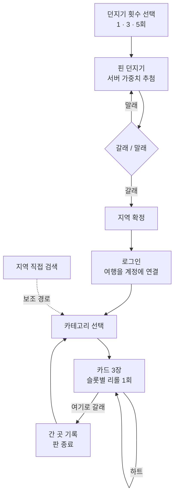
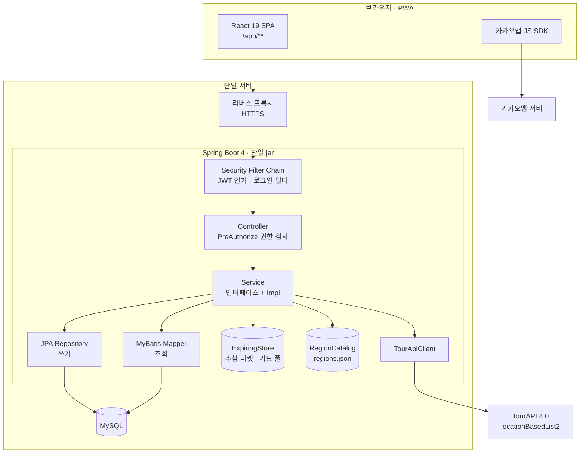
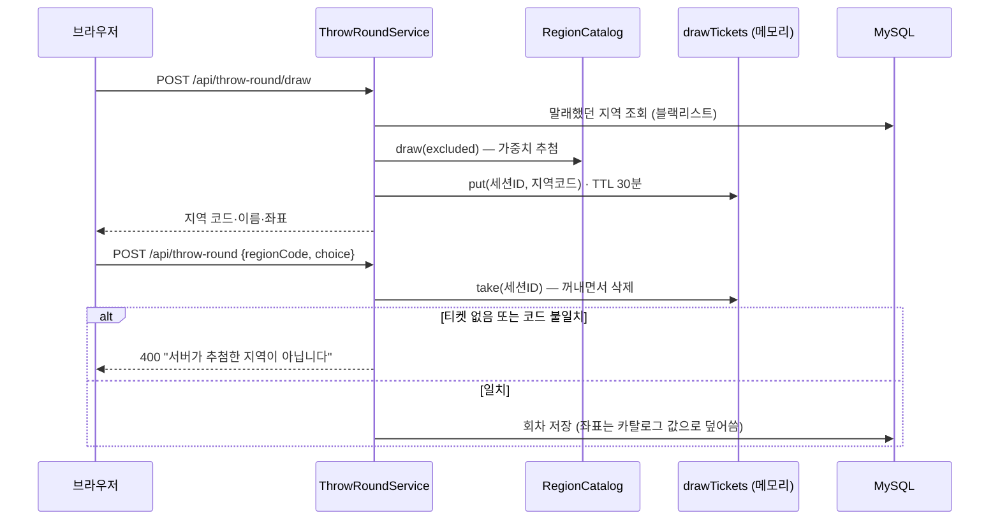
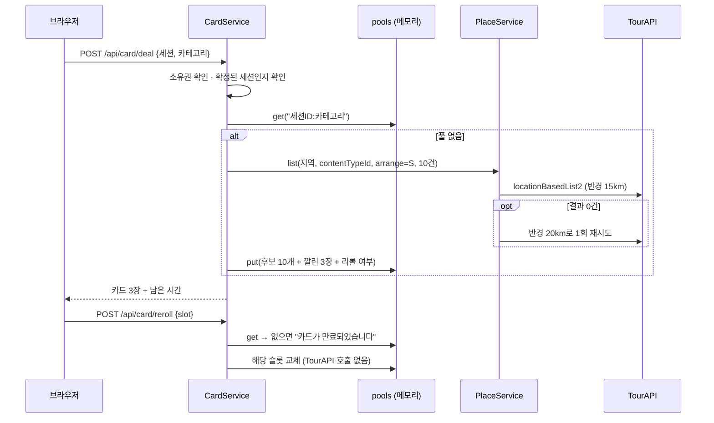
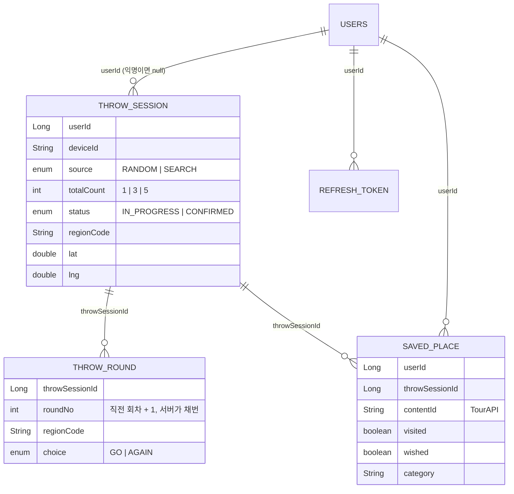

# 갈래 말래

> 지도에 핀을 던져 여행지를 정하고, 그 지역에서 카드 3장으로 갈 곳을 고르는 즉흥 여행 서비스

**2026 관광데이터 활용 공모전 (웹·앱 구현 부문)** 출품작 · 1인 개발 · 한국관광공사 TourAPI 4.0 활용

---

## 목차

1. [기획 의도](#1-기획-의도)
2. [기획하면서 신경 쓴 점](#2-기획하면서-신경-쓴-점)
3. [사용 흐름](#3-사용-흐름)
4. [아키텍처](#4-아키텍처)
5. [동작 방식: 핵심 흐름](#5-동작-방식-핵심-흐름)
6. [외부 API 연동](#6-외부-api-연동)
7. [데이터 모델](#7-데이터-모델)
8. [보안](#8-보안)
9. [프로젝트 구조](#9-프로젝트-구조)
10. [로컬 실행](#10-로컬-실행)
11. [한계와 다음 단계](#11-한계와-다음-단계)

---

## 1. 기획 의도

### 문제
관광객이 유명 관광지에만 몰립니다. 특정 지역은 혼잡하고 환경 부담이 커지지만, 나머지 지역은 관광 수요를 거의 받지 못합니다.

### 해결 방향
비인기 지역을 **억지로 밀면** 사용자는 반감을 갖습니다. 그래서 랜덤이 주는 재미를 매개로, 사용자가 **스스로** 낯선 지역을 고르게 만듭니다.

- 지도에 핀을 던지면 지역이 정해집니다. 추첨은 **소외 지역에 가중치**를 준 확률로 이루어집니다.
- 3회나 5회 던지기를 고르면, 매 회차마다 **갈래(확정) / 말래(다시 던지기)** 를 고릅니다. "이번 결과를 받아들일까, 버리고 다시 던질까"를 고민하는 긴장감 자체가 재미 요소입니다.
- 지역이 정해지면 카테고리(관광지·음식·숙박·행사·레포츠)를 그때그때 하나씩 고릅니다. 그 지역 장소 중 **카드 3장**이 깔리고, 마음에 드는 곳을 고릅니다.

### 타겟
숏폼에 익숙하고 랜덤에서 재미를 느끼는 2030입니다. 계획 없이 일단 떠나지만, 결과는 만족스러운 여행이길 바라는 사람들입니다.

---

## 2. 기획하면서 신경 쓴 점

| 결정 | 이유 |
|---|---|
| **랜덤은 "지역"까지만** | 무엇을 할지는 사용자가 직접 고릅니다. 완전 자동 추천도, 완전 자유 검색도 아닌 절충입니다. |
| **인기 지역도 배제하지 않음** | 전국 230개 시군구 중 인기 지역 30곳은 가중치 0.2, 나머지는 1.0입니다. 확률만 다르게 줘서 인기 지역도 가끔은 뽑힙니다. |
| **추첨은 서버가 함** | 클라이언트가 지역을 보내게 두면, 원하는 지역으로 "던진 척"을 할 수 있습니다. 서버가 추첨하고 1회용 티켓으로 대조합니다. |
| **던지기까지는 로그인 없이** | 로그인 장벽 없이 "던져서 지역이 나오는 재미"를 먼저 보여줍니다. 지역이 확정된 뒤의 카테고리·카드부터 회원 전용입니다. |
| **익명으로 던진 여행을 이어서 진행** | 로그인 직후, 로그인을 유발한 그 여행 하나만 계정에 연결합니다. 처음부터 다시 던지지 않아도 됩니다. |
| **지역 직접 검색은 일부러 약하게** | 230개 시군구 안에서 이름으로만 찾고, 결과는 최대 20건, 로그인한 사람만 씁니다. 검색이 강해지면 인기 지역만 골라 가는 경로가 되기 때문입니다. |
| **카드 리롤은 슬롯마다 1회** | 화면을 나갔다 들어와도 30분 안에는 같은 카드와 같은 리롤 상태가 유지됩니다. 새로 고침으로 리롤을 되살릴 수 없습니다. |
| **한 판은 한 곳으로 끝남** | "여기로 갈래"로 한 곳을 고르면 그 카테고리의 판이 닫힙니다. 다시 누르면 새 카드 3장과 새 리롤이 깔립니다. 하루치 결정 단위로 잘랐습니다. |
| **간 곳과 찜을 분리** | 실제로 간 곳(`visited`)과 마음에 든 곳(`wished`)은 서로 독립된 표시입니다. 한 장소에 둘 다 켤 수 있습니다. |
| **개인정보 최소 수집** | 아이디·비밀번호·이름만 받습니다. 본인확인과 이메일 필수 입력은 넣지 않았고, 만 14세 미만은 가입할 수 없다고 고지합니다. |
| **모바일 우선 PWA** | 홈 화면에 추가했을 때가 기본 상태입니다. 데스크톱에서는 같은 한 칼럼을 가운데 정렬합니다. |

---

## 3. 사용 흐름



- 로그인 없이 쓸 수 있는 구간: 던지기 → 지역 확정
- 로그인이 필요한 구간: 카테고리 → 카드 → 간 곳·찜 → 내 여행 / 찜 목록

---

## 4. 아키텍처



### 설계 포인트

- **단일 오리진**: Vite로 빌드한 결과물을 `static/app/`에 넣어 jar 하나로 서빙합니다. CORS 설정이 필요 없고, 서버에서 Node 빌드를 돌리지 않습니다.
- **읽기와 쓰기 분리**: 쓰기와 단순 조회는 JPA Repository, 목록·조건 조회는 MyBatis Mapper가 맡습니다. 목록은 Mapper로 id만 가져오고, 상세는 서비스가 채웁니다.
- **JPA 연관관계 미사용**: FK는 `Long` 필드로만 들고 있습니다. 하위 데이터 삭제는 Cascade 대신 서비스에서 직접 순회하며 Soft Delete합니다.
- **런타임 외부 호출은 하나뿐**: 카드 후보를 처음 만들 때만 TourAPI를 부릅니다. 지역 추첨과 검색은 전부 메모리(`RegionCatalog`)에서 처리합니다.

### 기술 스택

| 영역 | 사용 기술 |
|---|---|
| Backend | Java 17, Spring Boot 4.1, Spring Security, JPA, MyBatis, jjwt 0.12, springdoc 3 |
| Frontend | React 19, React Router 7, Vite 7, 카카오맵 JS SDK, PWA manifest |
| DB | MySQL (테스트는 H2) |
| Build | Gradle. 프론트 빌드를 `processResources` 앞에 연결해 jar 하나로 산출 |

---

## 5. 동작 방식: 핵심 흐름

### 5-1. 던지기와 추첨 검증



### 5-2. 카드 깔기와 리롤



### 5-3. 인메모리 상태

DB에 넣기엔 수명이 짧고, 잃어버려도 "다시 요청"으로 복구되는 값만 메모리에 둡니다.

| 저장소 | 키 → 값 | TTL / 최대 개수 | 사라지면 |
|---|---|---|---|
| `drawTickets` | 세션 ID → 추첨된 지역 코드 | 30분 / 10,000 | "다시 던져주세요" |
| `pools` | `세션ID:카테고리` → 후보 10개, 깔린 3장, 리롤 여부 | 30분 / 2,000 | "카드를 다시 받아주세요" |
| `RegionCatalog` | 지역 코드 → 이름·좌표·가중치 | 없음 (읽기 전용) | jar에 포함되어 있어 해당 없음 |

`ExpiringStore` 동작 방식:
- `ConcurrentHashMap` 기반입니다.
- 만료는 조회할 때 확인합니다(지연 만료). 별도 스케줄러 스레드가 없습니다.
- 최대 개수를 넘으면 만료된 것부터 지우고, 그래도 넘치면 저장 순번이 오래된 것부터 지웁니다.

### 5-4. 간 곳·찜 저장 (upsert)

- `POST /api/saved-place` 하나로 저장과 해제를 모두 처리합니다. 클라이언트는 바꾸려는 플래그만 보냅니다.
- `(userId, throwSessionId, contentId)`로 기존 행을 찾습니다. Soft Delete된 행도 찾아서, 있으면 되살려 갱신합니다. 이 방식으로 UNIQUE 제약 충돌을 피합니다.
- `visited=true` 저장에 성공하면 해당 카테고리의 카드 풀을 버립니다. 이 시점에 판이 끝납니다.

---

## 6. 외부 API 연동

| API | 언제 쓰나 | 호출 주체 | 인증 방식 | 쓰는 기능 |
|---|---|---|---|---|
| **TourAPI 4.0** (KorService2) | 서비스 중, 카드 후보를 만들 때 | 서버 `TourApiClient` | serviceKey (쿼리스트링) | `locationBasedList2` |
| TourAPI 4.0 | 1회성 시딩 | `RegionSeedRunner` (테스트 소스) | 위와 같음 | `ldongCode2` (시도 → 시군구) |
| **카카오 로컬 API** | 1회성 시딩 | `KakaoLocalClient` | `Authorization: KakaoAK` 헤더 | 시군구명 → 좌표 |
| **카카오맵 JS SDK** | 서비스 중, 지도 화면 | 브라우저 | JS 키 + 사이트 도메인 등록 | 지도 렌더링 |

### TourAPI 호출 파이프라인

```
CardService.createPool()
  → PlaceService.list()          입력 보정·검증 (반경·건수 상한, 정렬 허용 목록)
  → TourApiClient.call()         RestClient.exchange · 타임아웃 3s/5s
  → verifyAndGetBody()           세 가지 응답 형태 판별
  → parseList()                  TourApiDto (external 전용 DTO)
  → PlaceService.toPlaces()      PlaceDto (도메인 DTO) — 여기가 경계선
```

### 다룬 문제들

- **응답 형태가 세 가지입니다.**
  - 정상: `{response:{header,body}}`
  - 게이트웨이 오류: 매뉴얼에 없는 평탄한 형태 `{resultCode, resultMsg}`
  - 인증키 오류: JSON을 요청해도 **XML**로 옵니다.
  
  최상위 키와 첫 글자로 구분합니다.
- **`item`의 형태가 건수마다 다릅니다.** 여러 건이면 배열, 1건이면 객체, 0건이면 빈 문자열로 옵니다. 세 경우를 `forEachItem()` 한 곳에서 처리합니다.
- **인증키가 새지 않게 막았습니다.**
  - TourAPI 키는 URI에 들어갑니다. RestClient의 기본 예외 메시지에 URI가 그대로 실리므로, `exchange()`로 응답을 직접 받고 로그·예외에는 마스킹한 문자열만 남깁니다.
  - 카카오는 키가 틀리면 **응답 본문에 키를 그대로 되돌려줍니다**(`wrong appKey(...)`). 패턴 마스킹과 설정값 치환을 이중으로 적용했습니다.
- **일일 한도(1,000건)를 지키는 장치를 뒀습니다.**
  - 실패한 호출도 한도에서 차감됩니다. 그래서 정렬값은 허용 목록으로 미리 막고, 반경·건수는 상한으로 깎아서 보냅니다.
  - 카드 후보를 30분 동안 재사용하므로 리롤할 때는 외부 호출이 없습니다.
  - 결과가 0건이어도 저장해 둡니다(negative caching).
  - 장소·카드 API는 로그인이 필요합니다.
  - 외부 API를 실제로 호출하는 테스트는 기본으로 꺼 둡니다.
- **좌표 축에 주의했습니다.** TourAPI는 `mapX`가 경도, `mapY`가 위도입니다.
- **지역 후보 시딩 (`regions.json`, 230개 시군구)**
  - 일반구가 있는 시는 대표 1건만 넣었습니다(268 → 230). 성남시처럼 구가 여러 개인 시가 몇 배 확률로 뽑히는 왜곡을 막기 위해서입니다.
  - 다시 돌리면 이미 있는 항목은 건너뜁니다. 쿼터를 아끼고, 손으로 조정한 가중치도 보존됩니다.
- **외부 응답 DTO와 도메인 DTO를 섞지 않았습니다.** TourAPI의 필드명이 바뀌어도 컨트롤러와 프론트는 영향받지 않습니다.

> 관광 정보 출처: ⓒ한국관광공사

---

## 7. 데이터 모델



- 모든 엔티티는 `AuditingFields`(id, deleted, createdAt, modifiedAt)를 상속합니다. 기본 삭제 방식은 Soft Delete입니다.
- `ThrowSession`은 던지기 한 번이 아니라 **여행 하나**를 담는 단위입니다. 종료 개념이 없어서 2일차에도 같은 여행에서 이어서 고를 수 있습니다.
- 회원 탈퇴는 `withdraw()`로 처리합니다. 식별 가능한 필드를 되돌릴 수 없는 값으로 덮어쓴 뒤 Soft Delete합니다.

---

## 8. 보안

**인증**
- Refresh Token은 `POST /api/login`, Access Token(30분)은 `POST /api/auth`로 받습니다.
- 로그아웃하면 서버의 Refresh Token을 하드 삭제합니다.

**401과 403 구분**
- 프론트는 **401일 때만** 토큰을 재발급합니다.
- 서버의 `GlobalExceptionHandler`는 비로그인 요청에 401, 로그인했지만 권한이 없는 요청에 403을 돌려줍니다.

**소유권 검증**
- 주인이 있는 세션은 `userId`로만, 익명 세션은 `X-Device-Id`로만 판단합니다. 두 경로를 섞지 않습니다.
- 목록 쿼리의 소유자 조건은 `<choose>…<otherwise>AND 1 = 0`으로 작성합니다. 조건이 빠지면 전체가 아니라 0건이 나옵니다.

**클라이언트 값 불신**
- 지역 좌표, 회차 번호, 목록 조회의 userId는 서버가 덮어씁니다.

**필터 단계 오류**
- 필터에서 난 오류도 `{"error": "..."}` 형태의 JSON으로 직접 응답합니다. 스택트레이스가 노출되지 않게 막습니다.

**토큰 저장 위치**
- 토큰은 `sessionStorage`에 둡니다. 저장 위치를 `token.js` 한 곳에 모아 두어, httpOnly 쿠키로 바꿀 때 이 파일만 고치면 됩니다.

**비밀값**
- `application.yml`과 `.env*.local`은 gitignore 대상이라 서버에만 있습니다.

---

## 9. 프로젝트 구조

```
src/main/java/com/thc/goornotdev
├── config          SecurityConfig · MybatisConfig · SwaggerConfig
├── controller      REST 컨트롤러 (Auth, Card, Place, Region, SavedPlace, ThrowRound, ThrowSession, User)
│   └── page        SPA 포워딩 (/app/** → React)
├── domain          엔티티 5 + enum 4
├── DTO             outer class + static inner (CreateReq / UpdateReq / DetailRes / ListReq)
├── exception       도메인 예외 + GlobalExceptionHandler
├── external
│   ├── tourapi     TourApiClient · TourApiProperties · TourApiDto
│   └── kakao       KakaoLocalClient · KakaoLocalProperties · KakaoLocalDto
├── mapper          MyBatis (resources/mapper/*.xml)
├── repository      JPA
├── security        JWT 필터 · AuthService · PrincipalDetails
├── service/Impl
└── util            ExpiringStore · RegionCatalog

frontend/src
├── routes          Home · Category · Cards · Search · MyTrips · Wishlist · My · Login · Signup · Privacy
├── components      AppShell · TabBar · RequireAuth · Icon
└── lib             api(fetch + 토큰 재발급) · token · device · auth · trip · place
```

---

## 10. 로컬 실행

### 준비
- JDK 17, Node 20 이상, MySQL 8
- `src/main/resources/application.yml`을 직접 만들어야 합니다(저장소에 없음). 필요한 키 이름은 다음과 같습니다.

```yaml
spring.datasource: url / username / password
server.port: 8081
external:
  jwt: tokenSecretKey, tokenPrefix, accessKey, accessTokenExpirationTime, refreshKey, refreshTokenExpirationTime
  tourapi: service-key (인코딩 키), base-url
  kakao: rest-api-key, local-base-url
```

- 지도를 쓰려면 `frontend/.env.local`에 `VITE_KAKAO_JS_KEY=<카카오 JS 키>`를 넣습니다.

### 빌드와 실행

```bash
./gradlew clean build          # 프론트 빌드까지 포함해 jar 하나 생성
java -jar build/libs/goOrNotDev-0.0.1-SNAPSHOT.jar
# → http://localhost:8081/app
```

| 명령 | 용도 |
|---|---|
| `./gradlew build -PskipFrontend` | 프론트 빌드 생략 |
| `cd frontend && npm run dev` | 프론트만 개발 서버로 실행 |
| `./gradlew test` | 단위 테스트 (외부 API 호출 없음) |
| `./gradlew test -Dtourapi.live=true` | TourAPI 실제 호출 테스트 |
| `./gradlew test --tests '*RegionSeedRunner' -Dregion.seed=true` | `regions.json` 시딩 |

---

## 11. 한계와 다음 단계

**현재 한계**
- 인메모리 상태가 인스턴스 로컬이라 **서버 1대 전제**입니다. 서버를 늘리려면 Redis나 세션 어피니티가 필요합니다.
- 카드 풀의 키에 세션 ID가 들어 있어 **사용자 간에 공유되지 않습니다.** 같은 지역·같은 카테고리라도 사용자마다 TourAPI를 따로 호출합니다.

**다음 단계**
- **캐시**: TourAPI 응답을 지역·카테고리 단위의 공유 캐시(Caffeine)로 분리하고, 적중률을 메트릭으로 수집
- **관측**: Actuator·Micrometer 메트릭, 구조화 로그(traceId 포함), Grafana(LGTM) 대시보드와 알림
- **CI/CD**: GitHub Actions에서 테스트·빌드를 돌리고 서버에 배포 → 헬스체크
- **기능**: 던지기를 다 쓰고도 아무 지역도 고르지 않았을 때의 재던지기 대기시간(서버에서 검증), 찜 횟수 기반 자체 인기순
